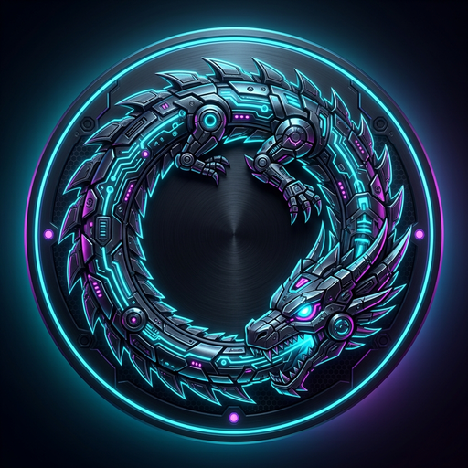

# ⚡ Z Downloader // Cyberpunk Edition (v0.0.0)

<p align="center">
  
</p>

<p align="center">
  <b>High-Speed Multi-Stream Media, BitTorrent &amp; IDM-Style Download Engine for Windows</b><br/>
  <i>Engineered with Tauri 2, Rust, React 18, aria2c, and yt-dlp.</i>
</p>

<p align="center">
  
  
  
  
</p>

---

## 🌟 Key Features

### ⚡ 1. IDM-Style Download Interceptor
* **Automatic Browser Interception:** Chrome, Edge, and Brave extension automatically intercepts file downloads (`.exe`, `.zip`, `.iso`, `.pdf`, `.mp4`, etc.) and immediately transfers them to Z Downloader.
* **16-Connection Parallel Acceleration:** File chunks are downloaded simultaneously via `aria2c` multi-connection engine.
* **Pause & Resume:** Full support for broken or paused connections without losing downloaded bytes.

### 🧲 2. qBit Torrent Downloader Engine
* **Direct Magnet & .torrent Support:** Paste any magnet URI (`magnet:?xt=urn:btih:...`) or `.torrent` file directly.
* **Decentralized Network:** Built-in DHT, PEX (Peer Exchange), and multi-tracker support.
* **Live Torrent Metrics:** Real-time download/upload speed, peer counts, seeds, ETA, and progress tracking.

### 🎥 3. Universal Media Downloader & Clipper
* **1000+ Video & Audio Sites:** Full integration with `yt-dlp` and `FFmpeg` for 4K UHD, 60fps, 1080p, MP4, MKV, MP3, FLAC, and OPUS.
* **Precision Clipper:** Extract keyframe-accurate video and audio segments with start/end timestamps.
* **Subtitles & Metadata:** Auto-fetch multi-language subtitles and embed cover art.

### 🛡️ 4. Lightweight & Low Memory
* **Tauri 2 + Native Rust:** Uses Microsoft WebView2 runtime—consuming only **~35-50 MB RAM** compared to Electron's 300-500 MB.
* **Circular Dragon Emblem:** Futuristic neon HUD aesthetics with Cyberpunk design cues.

---

## 🧩 Browser Extension Setup (Chrome / Edge / Brave)

1. Open your browser and navigate to:
   * Chrome: `chrome://extensions`
   * Brave: `brave://extensions`
   * Edge: `edge://extensions`
2. Enable **Developer mode** (toggle in the top-right corner).
3. Click **Load unpacked**.
4. Select the `browser-extension` folder inside this directory:
   ```
   D:\Antigravity\Z downloader\browser-extension
   ```
5. *(Optional Windows Protocol Registration)*: Run `register-zdownloader-protocol.bat` to register `zdownloader://` and `zdl://` so clicking links outside the browser automatically launches Z Downloader!

---

## 🏗️ Building From Source

```bash
# 1. Install frontend dependencies
npm install

# 2. Build React UI
npm run build

# 3. Build & bundle Windows NSIS installer
npm run tauri build
```

---

## 📜 License & Credits

* **Developer:** Golam Mowla
* **GitHub Repository:** [https://github.com/golam-mowla/Z-Downloader](https://github.com/golam-mowla/Z-Downloader)
* **Release Version:** 0.0.0
